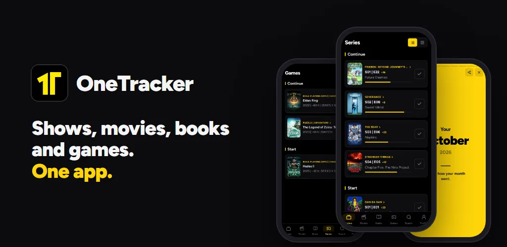
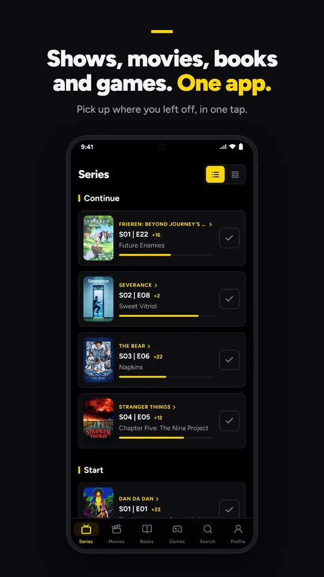
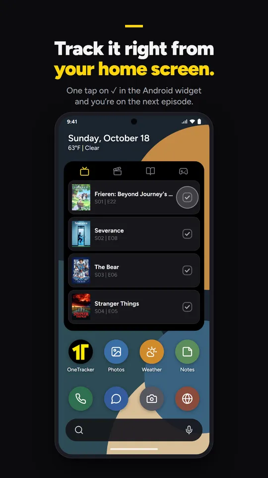
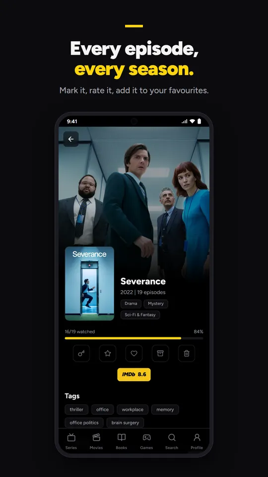
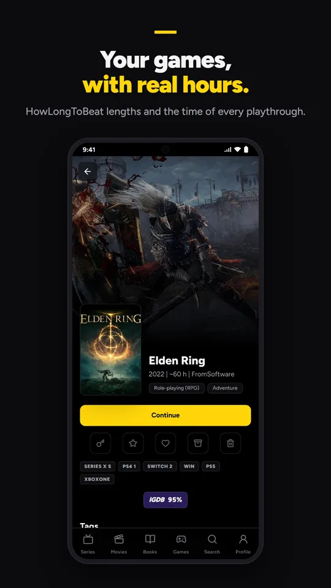
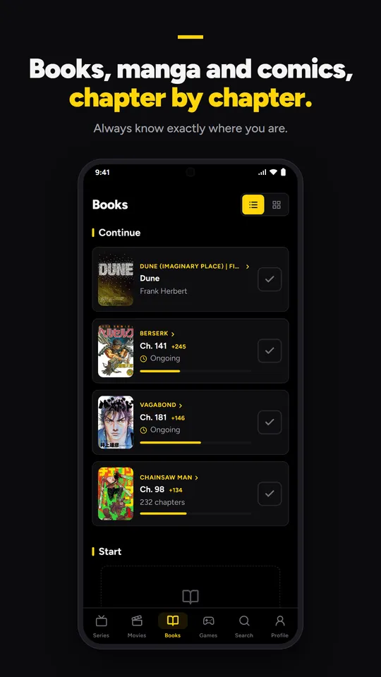
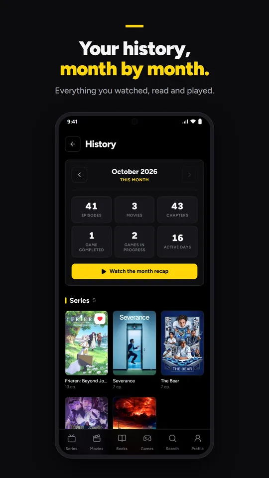
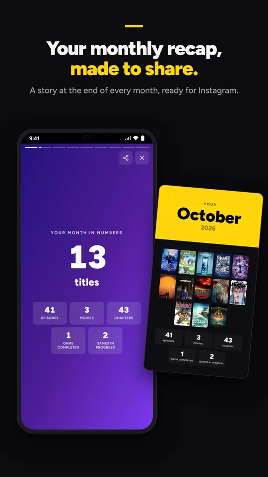
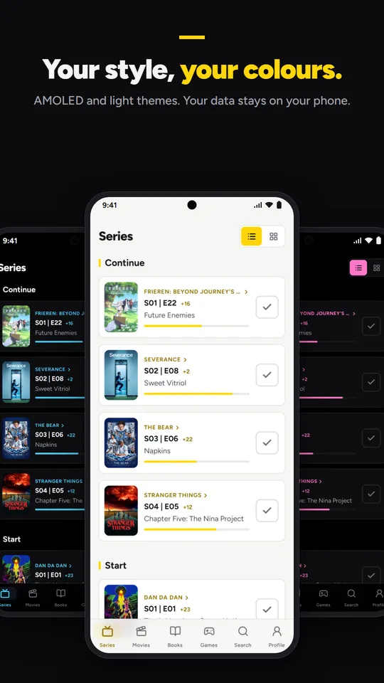

<p align="center"></p>

<h1 align="center">OneTracker</h1>

<p align="center">One app to keep track of the shows, anime, movies, books, manga, comics and games in your life.<br/>Free, no ads, no account needed.</p>

<p align="center"></p>

<p align="center">
  
  
  
  
</p>
<p align="center">
  
  
  
  
</p>

## Get it

- **Android** — on Google Play soon (closed testing now).
- **Web** — [onetracker.onetracker.workers.dev](https://onetracker.onetracker.workers.dev), on any computer or phone.
- **iPhone** — the app is ready; publishing on the App Store depends on how many people want it.

## What it does

- **Shows and anime**: tap ✓ for the next episode, "Continue" shows where you left off, rewatches are counted.
- **Movies, books, manga and comics**: from "to start" to "finished", chapter by chapter where it makes sense.
- **Games**: HowLongToBeat lengths and the hours of each playthrough.
- **Your month**: a month-by-month history and a recap at the end of each month, ready to share.
- **Stats and collections**: total time, ratings, achievements, favorites, lists and a knockout "Clash" between your favorites.
- **Home screen widget** on Android, themes (AMOLED in eight colours, light and more), English and Italian.
- **Coming from TV Time?** Import its export (GDPR zip or the plugin's JSON) and your history comes with you.
- A short **tutorial** on each screen the first time you open it, and a Guide in Settings.

## Your data

Your library lives on your device and works offline. Signing in with Google is
optional: it backs your library up to a private app folder in **your own** Google
Drive and keeps your devices in sync. No ads, no tracking.
[Privacy policy](https://onetracker.onetracker.workers.dev/privacy).

## Optional keys

Everything works out of the box. Two free keys add a little more, each with a
step-by-step guide inside the app:

- **Comic Vine** — western comics (Marvel, DC…).
- **OMDb** — IMDb, Rotten Tomatoes and Metacritic ratings.

## Build it yourself

```bash
npm install
npm run dev            # the web app at http://localhost:5173
npm run build          # typecheck + production build
npm run android:sync   # build + copy into the Android project (Capacitor)
```

How the code is organised, file by file: [docs/CODEBASE.md](docs/CODEBASE.md).

## Credits

Data and images from [TMDB](https://www.themoviedb.org/), [IGDB](https://www.igdb.com/),
[HowLongToBeat](https://howlongtobeat.com/), [AniList](https://anilist.co/),
[MangaDex](https://mangadex.org/), [Open Library](https://openlibrary.org/),
[Comic Vine](https://comicvine.gamespot.com/), [OMDb](https://www.omdbapi.com/) and
[Jikan](https://jikan.moe/), under their own terms.
This product uses the TMDB API but is not endorsed or certified by TMDB.

## License

[Mozilla Public License 2.0](LICENSE): use it, study it, change it. Modified files of
OneTracker stay open under the same licence.
